# Глубокое обучение: от свёрток до устойчивости нейросетей

**Исследовательский проект на PyTorch:** реализация базовых алгоритмов глубокого обучения, обучение ResNet на CIFAR-10 и оценка устойчивости классификаторов к adversarial-атакам.

   

> **Идея проекта:** не просто обучить классификатор, а разобраться, как устроены свёртки, нормализация и оптимизация, затем проверить, насколько точность сохраняется при целенаправленных искажениях входных изображений.

[Ключевые результаты](#ключевые-результаты) · [Эксперименты и графики](#галерея-экспериментов) · [Реализация](#что-реализовано) · [Запуск](#как-воспроизвести) · [Ограничения](#ограничения-исследования)

## Ключевые результаты

| **83,05%** | **70,40%** | **16 графиков** |
|:---:|:---:|:---:|
| Test accuracy **ResNet-20** на CIFAR-10 | PGD-20 accuracy **PGD-AT** при ε = 0,1 | Визуализации из финального запуска ноутбука |

В полном эксперименте (`FAST_MODE=False`) ResNet-20 обучена за 20 эпох, а модель с adversarial training при PGD-20 показала **70,40% против 0,60%** у стандартной сети. Цена робастности: снижение clean accuracy с **91,70% до 82,90%** (−8,80 п.п.). Все числа относятся к одному сохранённому прогону, а не к среднему по нескольким seed.

### Два главных результата

| Обучение ResNet-20 на CIFAR-10 | Устойчивость к PGD-атакам |
|:---:|:---:|
|  |  |
| **83,05% test accuracy**, 20 эпох | **70,40% PGD-20 accuracy** при ε = 0,1 |

## Галерея экспериментов

В репозитории **все 16 рисунков**, извлечённых из сохранённых результатов `hw1.ipynb`. Основные графики показаны прямо на странице; более подробные и служебные эксперименты раскрываются по нажатию.

### 1. Архитектуры и обучение

**Влияние глубины без residual-соединений.** При одинаковом бюджете обучения plain-20 достигла 78,62% test accuracy, а plain-56 — 54,83%. Более глубокая модель хуже и на train, что согласуется с проблемой оптимизации.


### 2. Атаки на классификаторы

**Направленные атаки (targeted PGD).** Матрица показывает долю примеров, переведённых атакой в заданный целевой класс. Направления несимметричны: Pullover → Sneaker — 18,02%, несколько переводов из Ankle boot — 100%.

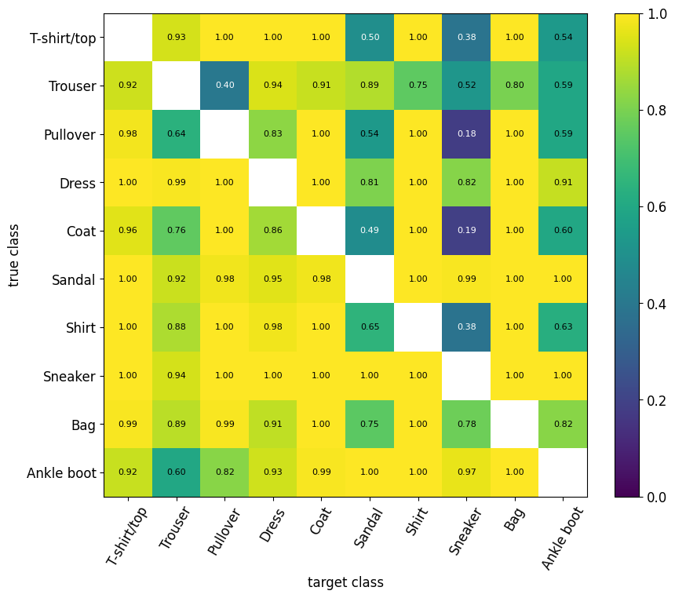

**Градиенты входных изображений.** Доля массы градиента на фоне уменьшилась с 59,25% до 21,36% после PGD-AT. Карты градиентов визуализируют локальную чувствительность, но сами по себе не доказывают робастность.


### 3. Дополнительные исследования робастности

**L0-атака.** При изменении 10 пикселей PGD-AT сохраняла 59,80% accuracy против 38,40% у стандартной модели; при 30 пикселях — 29,40% против 3,20%. Устойчивость к L∞ не гарантирует устойчивости к L0.

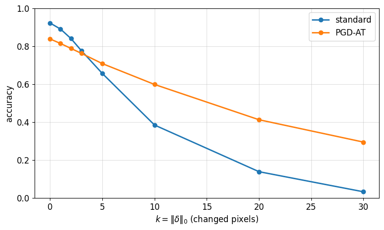

**Catastrophic overfitting.** Обычное FGSM adversarial training утратило устойчивость к PGD уже на ранних эпохах. FGSM-RS с random start сохранило существенно более высокую PGD-accuracy; в отдельной оценке PGD-100×5: 0% против 38,28%.


### 4. Оптимизация и Edge of Stability

**Sharpness и границы локальной устойчивости** `2/η`: при η = 0,05 и 0,1 оценки sharpness подошли к соответствующим границам.

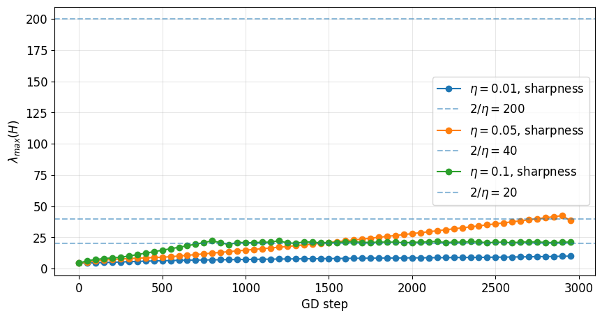

**Loss при разных learning rate.** Несмотря на всплески для больших шагов, общий тренд функции потерь оставался нисходящим.

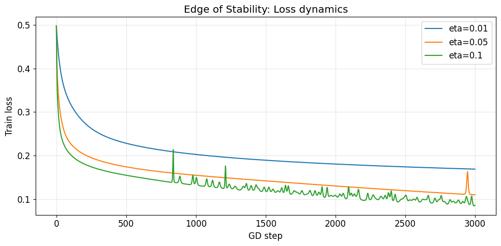

<details>
<summary><strong>Ещё 7 графиков: базовые алгоритмы, данные и визуализации PGD</strong></summary>

#### Теоретическое и эффективное рецептивное поле

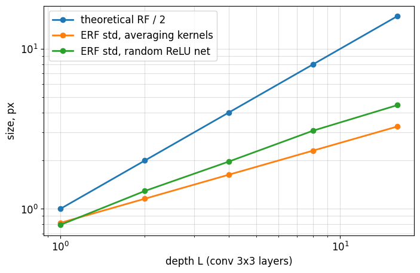

#### Инициализация Xavier, Kaiming и PyTorch default

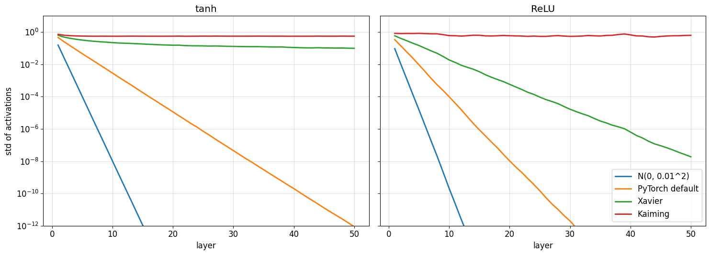

#### Влияние bias correction в AdamW

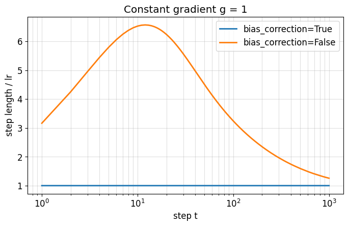

#### Cosine learning-rate schedule

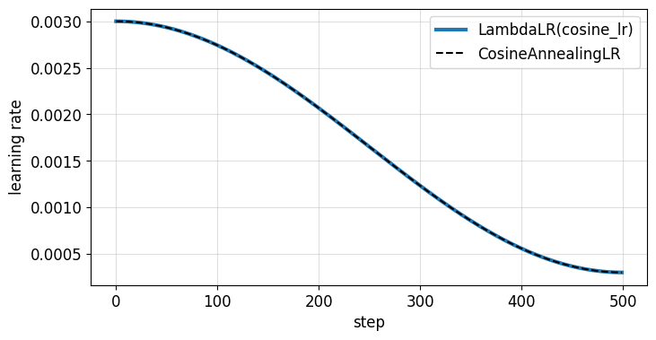

#### Примеры изображений CIFAR-10

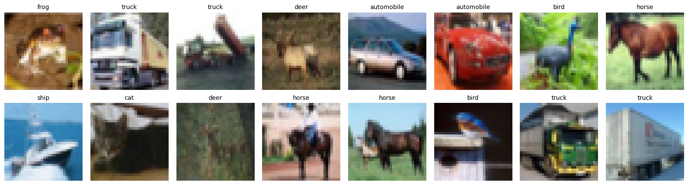

#### PGD-L2: зависимость accuracy от бюджета атаки

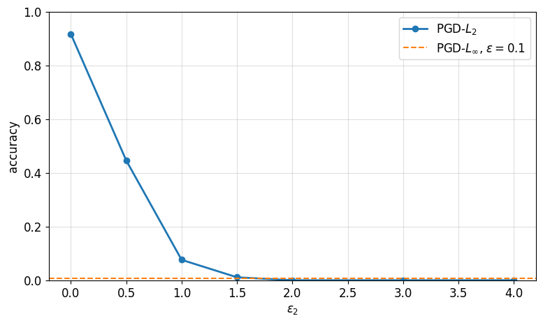

#### PGD-L2 и PGD-L∞: карты возмущений

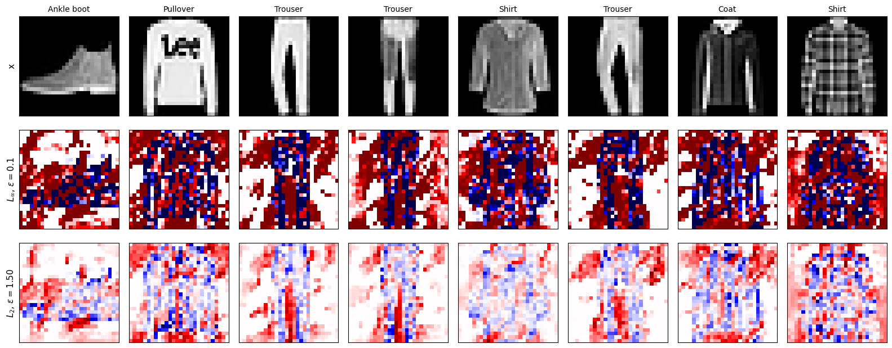

</details>

## Что реализовано

| Направление | Реализация |
|---|---|
| **Свёртки** | `conv2d` через `unfold`, собственный backward, `groups`, `dilation`, receptive field, FFT-свёртка |
| **Нормализация** | BatchNorm и объединение Conv + BatchNorm для inference |
| **Оптимизация** | Собственный AdamW, Xavier/Kaiming, cosine LR, исследование sharpness |
| **Классификация** | ResNet-20 на CIFAR-10; plain-20 и plain-56 без residual-связей |
| **Adversarial ML** | FGSM, PGD-L∞, PGD-L2, targeted PGD, PGD-7 adversarial training |
| **Диагностика устойчивости** | PGD-100×5, входные градиенты, L0-атаки, catastrophic overfitting |

В [`hw1.ipynb`](hw1.ipynb) сохранены код, открытые проверки, пояснения и результаты запуска. Это **учебный исследовательский notebook**, а не производственная библиотека с отдельным API.

## Структура репозитория

```text
.
├── README.md                    # Описание проекта и галерея результатов
├── hw1.ipynb                    # Выполненное задание со всеми outputs
├── artifacts/
│   ├── metrics.json             # Конфигурация и результаты экспериментов
│   ├── resnet20.pt              # Веса ResNet-20
│   ├── fashion_standard.pt      # Стандартный классификатор FashionMNIST
│   └── fashion_pgd_at.pt        # Классификатор после PGD adversarial training
├── figures/                     # Все 16 графиков из notebook
├── docs/
│   ├── methodology.md           # Методика и протоколы оценки
│   ├── results.md               # Подробные численные результаты
│   └── publishing-guide.md      # Работа с Git-ветками и Pull Request
├── scripts/check_submission.py  # Проверка ноутбука и артефактов
├── requirements.txt
└── .github/                     # CI и шаблон Pull Request
```

## Как воспроизвести

Самый простой способ — открыть [`hw1.ipynb`](hw1.ipynb) в [Google Colab](https://colab.research.google.com/), подключить GPU и выполнить ячейки по порядку. CIFAR-10 и FashionMNIST скачиваются автоматически.

Конфигурация финального запуска:

```python
FAST_MODE = False
ATTACK_TRACK = 'targeted'
BONUS_TASKS = {'7.1', '7.2', '7.4', '7.5'}
```

Для локального запуска в изолированной среде:

```bash
python3 -m venv .venv
source .venv/bin/activate
python -m pip install -r requirements.txt
python -m pip install jupyterlab
jupyter lab
```

Чтобы проверить сохранённую работу **без переобучения моделей**:

```bash
python scripts/check_submission.py
```

Полное переобучение требует GPU; численные результаты могут отличаться между устройствами и версиями PyTorch/CUDA.

## Ограничения исследования

- Исследование выполнено при фиксированном seed и конечном бюджете обучения: результаты не являются оценкой статистического превосходства архитектур.
- Robust accuracy зависит от типа атаки, ε, числа шагов, перезапусков, состава тестовой подвыборки и определения успешности.
- FGSM accuracy во время обучения и в отдельном sanity check использует разные протоколы — напрямую сравнивать их нельзя.
- Saliency-карты и эмпирическая PGD-устойчивость **не являются сертификатом безопасности**.

Подробности: [Методика](docs/methodology.md) · [Численные результаты](docs/results.md).

## Источники

- [He et al. — Deep Residual Learning for Image Recognition](https://arxiv.org/abs/1512.03385)
- [Madry et al. — Towards Deep Learning Models Resistant to Adversarial Attacks](https://arxiv.org/abs/1706.06083)
- [Luo et al. — Understanding the Effective Receptive Field in Deep CNNs](https://arxiv.org/abs/1701.04128)

---

*Учебный проект по глубокому обучению. Акцент — на реализации алгоритмов, воспроизводимых экспериментах и корректной интерпретации результатов.*
