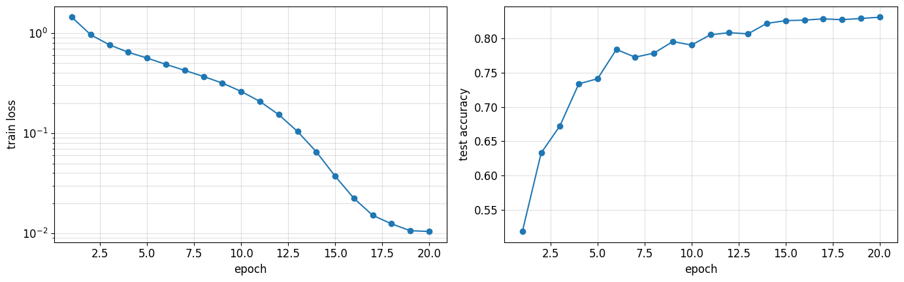
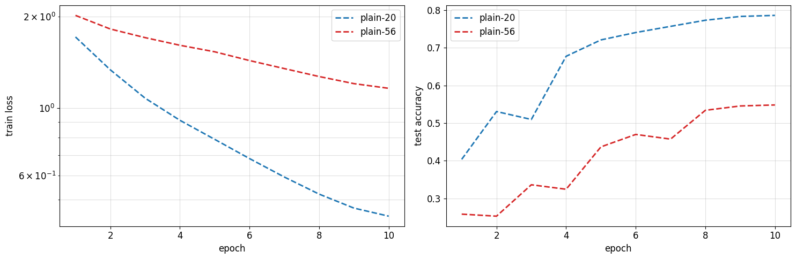
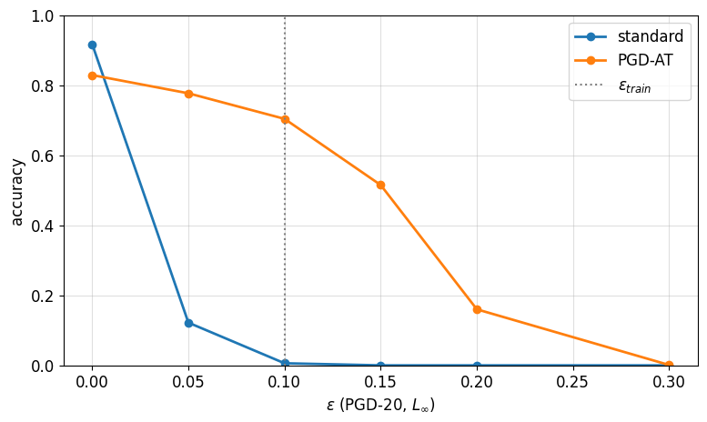
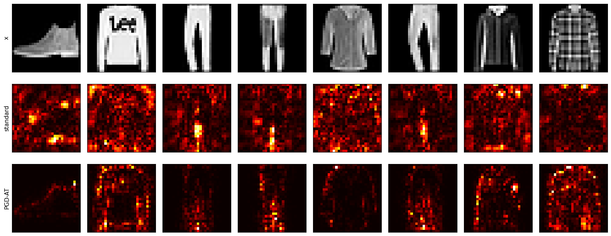
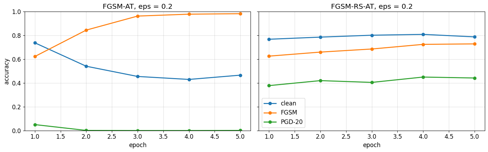

# Deep Learning from First Principles & Adversarial Robustness

**A reproducible research-style study of convolutional networks, optimization dynamics, and adversarial robustness in PyTorch.**

   

This project implements core deep learning components **from scratch**, trains compact residual networks, and measures how neural network predictions change under adversarial perturbations. It is based on a university deep learning assignment, but the repository is organized as a self-contained portfolio case study.

> **Highlights:** 83.05% CIFAR-10 test accuracy with ResNet-20 · 70.40% PGD-20 accuracy at ε = 0.1 after adversarial training (vs. 0.60% standard) · a controlled catastrophic-overfitting case study.

## At a glance

| Experiment | Result | What it demonstrates |
| :-- | --: | :-- |
| **ResNet-20 · CIFAR-10** | **83.05%** test accuracy | Residual learning with a custom training loop |
| Plain-20 vs. Plain-56 | 78.62% vs. 54.83% | Degradation of deeper plain networks under the same training budget |
| FashionMNIST · standard CNN | 91.70% clean accuracy | Baseline for robustness comparisons |
| FashionMNIST · PGD adversarial training | **70.40%** PGD-20 accuracy | Robustness under an L∞ attack, ε = 0.1 |
| Standard CNN under the same PGD-20 attack | 0.60% | Vulnerability of a naturally trained model |
| Saliency mass on background | 59.25% → 21.36% | Saliency becomes more concentrated on objects after PGD-AT |

Accuracy values come from the **recorded final run** in [`artifacts/metrics.json`](artifacts/metrics.json), not from a claimed benchmark or repeated-seed estimate. Training was run on a Tesla T4 with `FAST_MODE=False`; results can vary across systems and seeds.

## Results gallery

### 1 — Residual learning on CIFAR-10



The custom ResNet-20 reached **83.05%** test accuracy after 20 epochs. Training accuracy reached 99.98%, revealing a generalization gap of 16.93 percentage points.



Under the same 10-epoch budget, plain-56 achieved lower train *and* test accuracy than plain-20. This supports an **optimization/degradation** interpretation rather than an overfitting-only explanation.

### 2 — Robustness is measurable, and costly



At ε = 0.1, PGD-trained accuracy was **70.40%** versus **0.60%** for the standard model (PGD-20). Clean accuracy decreased from 91.70% to 82.90%: an **8.80 p.p. trade-off**. Stronger attacks and increasing ε were also evaluated; high single-step accuracy alone is not taken as evidence of robustness.



The PGD-trained model placed a smaller fraction of input-gradient magnitude on background pixels (21.36% vs. 59.25%). Saliency is an illustration, **not a certification** of robustness.

### 3 — Failure modes of fast adversarial training



In the recorded training trajectories, plain FGSM adversarial training lost PGD-20 robustness by the second/third epoch, despite increasing FGSM accuracy **under the training evaluation protocol**. FGSM with random start preserved substantially higher PGD-20 accuracy. The stronger PGD-100×5 check measured 0% for the FGSM model and 38.28% for FGSM-RS on its evaluation subset. These protocols are not interchangeable.

More experiments: [targeted attacks](figures/targeted_attack_heatmap.png) · [edge of stability](figures/edge_of_stability.png) · [L0 attacks](figures/l0_attack.png).

## What is implemented

- **Convolution fundamentals:** `conv2d` via `unfold`, handwritten convolution backward, theoretical and effective receptive fields, grouped/dilated convolutions, and FFT-based convolution.
- **Optimization:** manual BatchNorm, Conv+BatchNorm inference fusion, Kaiming/Xavier initialization experiments, a custom AdamW optimizer, cosine learning-rate scheduling, and sharpness tracking.
- **Image classification:** CIFAR ResNet-20, plain-network ablations at 20 and 56 layers, and FashionMNIST convolutional classifiers.
- **Adversarial ML:** FGSM, PGD-L∞ / PGD-L2, targeted PGD, PGD-7 adversarial training, attack-strength sanity checks, input-gradient diagnostics, L0-constrained attacks, and catastrophic-overfitting experiments.

The required algorithms are implemented as part of [`hw1.ipynb`](hw1.ipynb), with tests, explanations, and saved outputs. The repository retains the original cell structure and grading metadata.

## Repository map

```text
.
├── hw1.ipynb                    # Complete, executed research notebook
├── artifacts/
│   ├── metrics.json             # Recorded final-run metrics and configuration
│   ├── resnet20.pt              # CIFAR-10 ResNet-20 checkpoint
│   ├── fashion_standard.pt      # Naturally trained FashionMNIST checkpoint
│   └── fashion_pgd_at.pt        # PGD-7 adversarially trained checkpoint
├── figures/                     # Plots exported from actual notebook outputs
├── docs/
│   ├── methodology.md           # Methods, evaluation protocols, limitations
│   ├── results.md               # Numeric analysis of the final run
│   └── publishing-guide.md      # Branch, PR and reviewer workflow
├── scripts/check_submission.py  # Lightweight structure/artifact validation
├── requirements.txt            # Course-provided pinned dependencies
└── .github/                     # Pull-request template and CI validation
```

## Reproduce the experiments

**Fastest:** import [`hw1.ipynb`](hw1.ipynb) into [Google Colab](https://colab.research.google.com/), enable a GPU runtime, and run cells in order. CIFAR-10 and FashionMNIST are downloaded automatically. The final configuration is `FAST_MODE = False`, `ATTACK_TRACK = 'targeted'`, `BONUS_TASKS = {'7.1','7.2','7.4','7.5'}`. A full run requires a GPU and may take substantial time.

**Local:** the original dependency lock was tested with Python 3.13. Install the pinned packages in an isolated environment and open the notebook in Jupyter or VS Code:

```bash
python3 -m venv .venv
source .venv/bin/activate   # Windows: .venv\Scripts\activate
python -m pip install -r requirements.txt
python -m pip install jupyterlab
jupyter lab
```

To check the files without training or downloading the datasets:

```bash
python scripts/check_submission.py
```

Refer to [methodology](docs/methodology.md) for implementation and evaluation details, including why reported accuracies cannot be compared blindly across different attack protocols.

## Limitations and interpretation

This is a **single-run educational investigation**, not a production robustness guarantee. Accuracy depends on model, attack budget, evaluation subset, random restarts, and whether samples are required to be correctly classified before the attack. The clean/robust trade-off and saliency maps should not be treated as proof of certified adversarial robustness. There is no claim of state-of-the-art performance.

## Background reading

- [He et al. — Deep Residual Learning for Image Recognition](https://arxiv.org/abs/1512.03385)
- [Madry et al. — Towards Deep Learning Models Resistant to Adversarial Attacks](https://arxiv.org/abs/1706.06083)
- [Luo et al. — Understanding the Effective Receptive Field in Deep CNNs](https://arxiv.org/abs/1701.04128)

See the notebook for the full course-provided references and implementation context.

---

*Developed as a course project with a focus on transparent implementation, measurable experiments, and honest failure analysis.*
