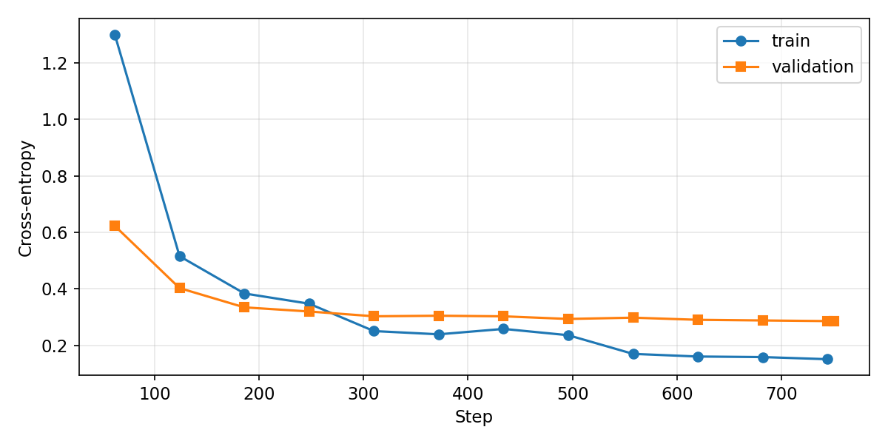
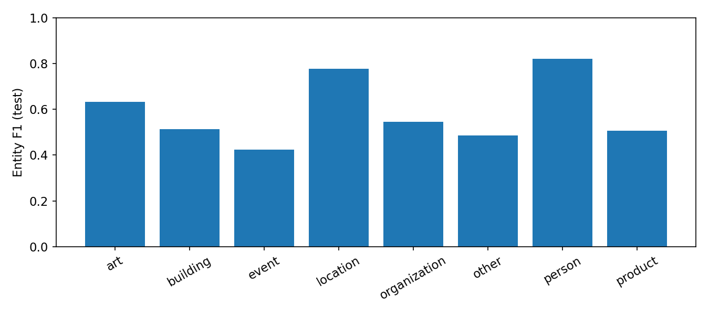

# ДЗ2. Распознавание именованных сущностей

Нугаева Камилла, J3312, 434674.

В работе дообучается BERT-Mini для поиска сущностей в английских текстах. Выбран вариант NLP. Код, ответы на вопросы и результаты запусков находятся в [hw2_nlp.ipynb](hw2_nlp.ipynb).

## Данные и обучение

Используется [Few-NERD, supervised](https://huggingface.co/datasets/DFKI-SLT/few-nerd): предложения из Wikipedia с ручной разметкой. Для экспериментов взяты 8000 предложений для обучения, 1500 для валидации и 1500 для теста. Точные повторы между выбранными сплитами удалены.

Разметка переведена из IO в BIO. Используются восемь типов: art, building, event, location, organization, other, person и product.

Модель — [BERT-Mini от Google](https://huggingface.co/google/bert_uncased_L-4_H-256_A-4), около 11 млн параметров. Ревизии модели и датасета зафиксированы в ноутбуке.

Параметры обучения: 3 эпохи, learning rate `3e-4`, batch size 32, длина до 128 сабвордов, seed 0. Основное обучение на CPU заняло около 7,6 минуты.

## Результаты

F1 считается по сущностям: должны совпасть тип и обе границы спана.

| Модель | Сплит | Micro F1 | Macro F1 |
|---|---|---:|---:|
| Словарный бейзлайн | validation | 0,2033 | 0,1327 |
| Энкодер со случайной головой | validation | 0,0107 | 0,0077 |
| BERT-Mini после дообучения | validation | 0,6531 | 0,5701 |
| BERT-Mini после дообучения | test | 0,6603 | 0,5881 |

На test precision составил 0,6342, recall — 0,6887. F1 по словам — 0,7387: отдельные слова модель определяет лучше, чем полные границы сущностей.

Лучше всего распознаются люди и географические названия. Слабее всего — события. На validation чаще встречаются ошибки типа сущности, чем пропуски или ошибки границ.

Дополнительно проверены следующие варианты. Все числа в таблице относятся к validation.

| Эксперимент | Micro F1 | Наблюдение |
|---|---:|---|
| Замороженный энкодер | 0,2911 | Обучение примерно вдвое быстрее, качество заметно ниже |
| BERT-Tiny | 0,5068 | Обучение заняло около 96 секунд |
| Опечатки в словах | 0,4237 | Качество снизилось; смена регистра результата не изменила |
| INT8 для FFN последнего слоя | 0,6521 | Потеря около 0,1 п.п.; заметного ускорения не получено |
| Порог уверенности 0,62, среднее по словам | 0,6709 | Precision вырос, recall снизился |

Порог и вариант квантизации выбирались по validation. Итоговая test-метрика основной модели приведена отдельно, без порога.

Это результаты одного запуска на подмножестве Few-NERD. Они не заменяют оценку на полном датасете. Основные ограничения — небольшой train, отсутствие признака регистра у модели и неоднозначные границы в исходной IO-разметке.

## Запуск

1. Открыть `hw2_nlp.ipynb` в Colab или Kaggle с доступом в интернет.
2. Выполнить первую ячейку с установкой зависимостей.
3. Для быстрой проверки поставить `FAST_MODE=True`, для полного запуска — `False`.
4. Выполнить все ячейки с начала и сохранить ноутбук вместе с созданным каталогом `artifacts/`.

Можно использовать GPU T4 или CPU. В сохраненном запуске использовался CPU и `FAST_MODE=False`.

В `artifacts/` находятся метрики, графики, история обучения и примеры ошибок. Полный отчет по типам и разбор примеров — в ноутбуке. Зависимости перечислены в `requirements_nlp.txt`. Данные и веса моделей скачиваются при запуске и в репозиторий не входят.

## Источники

- [Few-NERD: статья и описание разметки](https://aclanthology.org/2021.acl-long.248/), лицензия данных — [CC BY-SA 4.0](https://creativecommons.org/licenses/by-sa/4.0/). Примеры текстов и разметки в результатах приведены из этого датасета; разметка преобразована в BIO.
- [BERT Miniatures](https://huggingface.co/google/bert_uncased_L-4_H-256_A-4), лицензия моделей — Apache-2.0.
- [Hugging Face: token classification](https://huggingface.co/docs/transformers/tasks/token_classification).
- Условие и открытые тесты из шаблона ДЗ2. Полные сведения об источниках и использованных инструментах указаны в ноутбуке.
